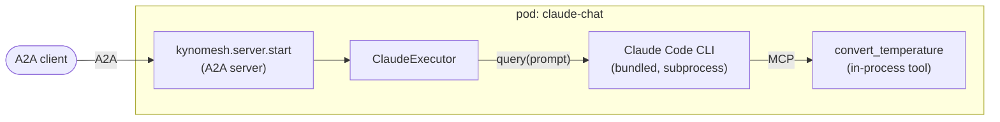

# Claude Agent SDK: single agent

A conversational agent built with the
[Claude Agent SDK](https://code.claude.com/docs/en/agent-sdk/python), served as
a one-agent Kynomesh `AgentSet`.

The Claude Agent SDK does not speak A2A, and does not need to. Kynomesh's Python
SDK runs the A2A server; the Claude agent is just what answers each message:



| File                          | Role                                                                                           |
| ----------------------------- | ---------------------------------------------------------------------------------------------- |
| `src/claude_chat/agent.py`    | `run_agent`: one `query()` per request, locked down for running in a pod. No Kynomesh imports. |
| `src/claude_chat/tools.py`    | A custom in-process tool (`@tool`) the agent can call.                                         |
| `src/claude_chat/executor.py` | Bridges an A2A message to `run_agent` and back.                                                |
| `src/claude_chat/main.py`     | The AgentCard, and serving via `kynomesh.server.start`.                                        |
| `manifests/agentset.yaml`     | The `AgentSet` (one agent, `Supervisor` pattern, `entry: chat-agent`).                         |

## What to know about the Claude Agent SDK

- Each request runs `query()`, which spawns the Claude Code CLI that ships
  inside the `claude-agent-sdk` wheel (about 100MB, so the image is large too).
  Expect a few seconds of startup per request.
- The agent runs in a pod, so `build_options()` locks it down: `tools=[]`
  removes every built-in tool (Bash, Read, Write, ...), `setting_sources=[]` and
  `strict_mcp_config=True` stop it loading anything from disk, `allowed_tools`
  lists only our tool, `permission_mode="dontAsk"` denies everything else
  instead of prompting, and `max_turns` bounds a run.
- The CLI writes state under `$HOME`; the Dockerfile points it at a writable dir
  because the container runs as `nobody`.

## Prerequisites

- Python 3.10+ and [uv](https://docs.astral.sh/uv/)
- An `ANTHROPIC_API_KEY`. The agent refuses to start without one.
- [`a2acli`](https://github.com/kynoproj/a2acli) (optional, for the CLI calls
  below)
- For the cluster run: Docker, `kubectl`, a local Kubernetes cluster with
  [Kynomesh installed](https://github.com/kynoproj/kynomesh/blob/main/docs/quick-start.md)

## 1. Run locally

```shell
uv run pytest                                           # unit tests, no API calls
ANTHROPIC_API_KEY=... uv run python -m claude_chat.main  # HTTP on :8088, gRPC on :8089
```

In another terminal:

```shell
curl localhost:8088/healthz
a2acli -u http://localhost:8088 send 'What is 72 F in Celsius?' -o json
```

Set `ANTHROPIC_MODEL` to pick a model; otherwise the SDK's default is used.

## 2. Run on Kynomesh

```shell
make build                     # builds claude-chat:latest
# kind:  kind load docker-image claude-chat:latest
# k3d:   k3d image import claude-chat:latest -c <cluster>
kubectl create secret generic anthropic-api-key --from-literal=ANTHROPIC_API_KEY=...
make deploy
kubectl get agentset           # PHASE should become Running
kubectl port-forward svc/claude-chat-ingress 8490
a2acli -k -u https://localhost:8490 --override-host=localhost:8490 send 'What is 72 F in Celsius?' -o json
make delete
```

Behind a TLS-intercepting proxy the image build fails certificate checks. Pass
the proxy CA: `make build CA_CERT=/path/to/ca.pem`.

> **Note:** the agent card sets `protocol_version` on each interface. Without it
> `a2acli` (a2a-go) fails with `no compatible transports found`.
