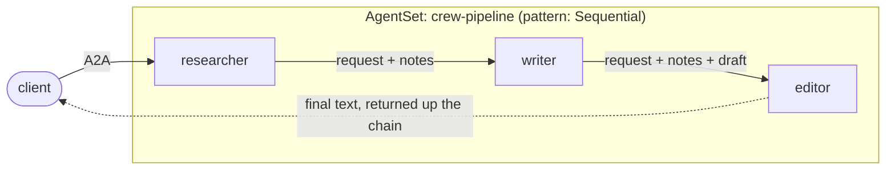

# CrewAI: a sequential pipeline

A three-stage [CrewAI](https://docs.crewai.com/) pipeline on Kynomesh's
`Sequential` pattern: a **researcher** gathers facts, a **writer** drafts from
them, and an **editor** tightens the draft. Each stage runs in its own pod and
hands its work to the next over A2A.



CrewAI does not speak A2A, and does not need to. Kynomesh's Python SDK runs each
stage's A2A server and makes the call to the next stage; CrewAI only sees the
text it is asked to work on.

| File                            | Role                                                                                         |
| ------------------------------- | -------------------------------------------------------------------------------------------- |
| `src/crew_pipeline/pipeline.py` | `next_stage` (who comes next, from the topology) and `chain` (do the work, forward, return). |
| `src/crew_pipeline/stages.py`   | The stages this image _can_ run (`researcher`, `writer`, `editor`) and their instructions.   |
| `src/crew_pipeline/agent.py`    | `build_agent` and `run_agent`: the CrewAI plumbing shared by every stage.                    |
| `src/crew_pipeline/peers.py`    | `ask_peer`: calls the next stage with `kynomesh.client.peer_client`. No URLs anywhere.       |
| `src/crew_pipeline/tools.py`    | `lookup_fact` (researcher) and `word_count` (editor).                                        |
| `src/crew_pipeline/main.py`     | Serves one stage via `kynomesh.server.start`; the stage comes from `--role`.                 |
| `manifests/agentset.yaml`       | One image, three agents. `pattern: Sequential`, `entry: researcher`.                         |

## How the pieces fit

- **The manifest is the pipeline.** With `pattern: Sequential`, each agent sees
  only the next agent in declaration order, and the entry must be the first
  agent. So `client.peers()` has one entry in the researcher and the writer, and
  none in the editor. A stage's code never names its successor: reorder or
  insert agents in the manifest and the chain follows.
- **The reply travels back up.** Each stage returns whatever its successor
  returned, so the client that called the researcher gets the editor's text.
- **The message grows into a transcript.** A stage forwards what it received
  plus its own labelled output (`Research notes:`, `Draft:`), so the editor sees
  the request, the notes and the draft. Nothing is parsed back out, and
  multi-paragraph requests survive intact.
- **A failing stage fails the request.** Unlike a supervisor, which can answer
  around a broken worker, a pipeline has nothing to return without its later
  stages, so a downstream error propagates back up.
- **Calls are awaited on the server's loop.** The hand-off happens in the stage
  handler, not inside a CrewAI tool, so the thread and event-loop caveat from
  the [supervisor](../supervisor) example does not apply here.
- Each stage is a standalone CrewAI `Agent` answered with `kickoff_async`, from
  a clean conversation each time. Agents run on OpenAI by default; set
  `OPENAI_MODEL` to pick a model (default `gpt-4o-mini`).
- CrewAI draws progress panels to stdout, keeps state under `$HOME` and sends
  telemetry by default. `run_agent` suppresses the panels, and the Dockerfile
  gives the `nobody` user a writable home and turns telemetry and tracing off.
- CrewAI needs Python below 3.14, so the project pins `requires-python` to
  `>=3.10,<3.14`.

## Prerequisites

- Python 3.10 to 3.13 and [uv](https://docs.astral.sh/uv/)
- An `OPENAI_API_KEY`. Agents refuse to start without one.
- [`a2acli`](https://github.com/kynoproj/a2acli) (optional, for the CLI calls
  below)
- For the cluster run: Docker, `kubectl`, a local Kubernetes cluster with
  [Kynomesh installed](https://github.com/kynoproj/kynomesh/blob/main/docs/quick-start.md)

## 1. Run the tests

```shell
uv run pytest    # the model and the peer calls are mocked
```

One test wires all three real CrewAI stages together in-process, with scripted
models, and follows a request down the chain and the answer back up.

Outside a cluster there is no topology, so a stage logs a warning and runs on
its own, without forwarding. That lets you try one stage locally:

```shell
OPENAI_API_KEY=... uv run python -m crew_pipeline.main --role editor
a2acli -u http://localhost:8088 send 'Draft: Kubernetes is a system that runs containers on many machines'
```

## 2. Run on Kynomesh

```shell
make build                     # builds crew-pipeline:latest
# kind:  kind load docker-image crew-pipeline:latest
# k3d:   k3d image import crew-pipeline:latest -c <cluster>
kubectl create secret generic openai-api-key --from-literal=OPENAI_API_KEY=...
make deploy
kubectl get agentset,agentdeploy     # AgentSet Running; 3 AgentDeploys Ready
kubectl port-forward svc/crew-pipeline-ingress 8490
```

Send the request to the first stage. The stage logs show the hand-offs:

```shell
a2acli -k -u https://localhost:8490 --override-host=localhost:8490 \
  send 'Write a short blurb about Kubernetes'
kubectl logs -l app.kubernetes.io/name=crew-pipeline-researcher -c agent | grep forwarding
make delete
```

The researcher's knowledge base covers Kubernetes, A2A, Japan and France.
Anything else makes it report "No facts found", and the later stages work from
that.

Behind a TLS-intercepting proxy the image build fails certificate checks. Pass
the proxy CA: `make build CA_CERT=/path/to/ca.pem`.

> **Note:** each agent card sets `protocol_version` on its interfaces. Without
> it `a2acli` fails with `no compatible transports found`.
