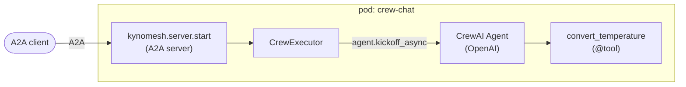

# CrewAI: single agent

A conversational agent built with [CrewAI](https://docs.crewai.com/), served as
a one-agent Kynomesh `AgentSet`.

CrewAI does not speak A2A, and does not need to. Kynomesh's Python SDK runs the
A2A server; the CrewAI agent is just what answers each message:



| File                        | Role                                                                                 |
| --------------------------- | ------------------------------------------------------------------------------------ |
| `src/crew_chat/agent.py`    | `build_agent` and `run_agent`: one `kickoff_async` per request. No Kynomesh imports. |
| `src/crew_chat/tools.py`    | A custom tool (`@tool`) the agent can call.                                          |
| `src/crew_chat/executor.py` | Bridges an A2A message to `run_agent` and back.                                      |
| `src/crew_chat/main.py`     | The AgentCard, and serving via `kynomesh.server.start`.                              |
| `manifests/agentset.yaml`   | The `AgentSet` (one agent, `Supervisor` pattern, `entry: chat-agent`).               |

## What to know about CrewAI

- A standalone `Agent` answers a message with `kickoff_async`, so there is no
  `Task` or `Crew` to wire up. Each request starts from a clean conversation.
- The agent runs on OpenAI by default. Set `OPENAI_MODEL` to pick a model
  (default `gpt-4o-mini`). Other providers work through CrewAI's `LLM`.
- `max_iter` bounds the tool-use loop.
- CrewAI draws progress panels to stdout, keeps state under `$HOME` and sends
  telemetry by default. `run_agent` suppresses the panels, and the Dockerfile
  gives the `nobody` user a writable home and turns telemetry and tracing off.
- CrewAI needs Python below 3.14, so the project pins `requires-python` to
  `>=3.10,<3.14`.

## Prerequisites

- Python 3.10 to 3.13 and [uv](https://docs.astral.sh/uv/)
- An `OPENAI_API_KEY`. The agent refuses to start without one.
- [`a2acli`](https://github.com/kynoproj/a2acli) (optional, for the CLI calls
  below)
- For the cluster run: Docker, `kubectl`, a local Kubernetes cluster with
  [Kynomesh installed](https://github.com/kynoproj/kynomesh/blob/main/docs/quick-start.md)

## 1. Run locally

```shell
uv run pytest                                          # unit tests, no API calls
OPENAI_API_KEY=... uv run python -m crew_chat.main     # HTTP on :8088, gRPC on :8089
```

In another terminal:

```shell
curl localhost:8088/healthz
a2acli -u http://localhost:8088 send 'What is 72 F in Celsius?' -o json
```

## 2. Run on Kynomesh

```shell
make build                     # builds crew-chat:latest
# kind:  kind load docker-image crew-chat:latest
# k3d:   k3d image import crew-chat:latest -c <cluster>
kubectl create secret generic openai-api-key --from-literal=OPENAI_API_KEY=...
make deploy
kubectl get agentset           # PHASE should become Running
kubectl port-forward svc/crew-chat-ingress 8490
a2acli -k -u https://localhost:8490 --override-host=localhost:8490 send 'What is 72 F in Celsius?' -o json
make delete
```

Behind a TLS-intercepting proxy the image build fails certificate checks. Pass
the proxy CA: `make build CA_CERT=/path/to/ca.pem`.

> **Note:** the agent card sets `protocol_version` on each interface. Without it
> `a2acli` fails with `no compatible transports found`.
