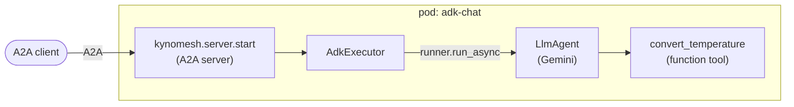

# Google ADK: single agent

A conversational agent built with the
[Google Agent Development Kit (ADK)](https://google.github.io/adk-docs/), served
as a one-agent Kynomesh `AgentSet`.

ADK has its own A2A support, but this example does not use it. Kynomesh's Python
SDK runs the A2A server; the ADK agent is just what answers each message:



| File                       | Role                                                                                                          |
| -------------------------- | ------------------------------------------------------------------------------------------------------------- |
| `src/adk_chat/agent.py`    | `run_agent`: one fresh in-memory session per request, final text out. No Kynomesh imports.                    |
| `src/adk_chat/tools.py`    | A plain Python function the agent can call as a tool. ADK builds its schema from the signature and docstring. |
| `src/adk_chat/executor.py` | Bridges an A2A message to `run_agent` and back.                                                               |
| `src/adk_chat/main.py`     | The AgentCard, and serving via `kynomesh.server.start`.                                                       |
| `manifests/agentset.yaml`  | The `AgentSet` (one agent, `Supervisor` pattern, `entry: chat-agent`).                                        |

## What to know about ADK

- The agent runs on Gemini through the Gemini API. Set `GOOGLE_MODEL` to pick a
  model (default `gemini-2.5-flash`).
- Each A2A request gets its own `InMemoryRunner` session, so requests do not
  share history. Swap in a persistent `SessionService` and reuse the A2A
  `context_id` as the session id if you want multi-turn conversations.
- Tools are plain functions. Return a dict, and describe every argument in the
  docstring: ADK passes it to the model.

## Prerequisites

- Python 3.10+ and [uv](https://docs.astral.sh/uv/)
- A `GOOGLE_API_KEY` from
  [Google AI Studio](https://aistudio.google.com/apikey). The agent refuses to
  start without one.
- [`a2acli`](https://github.com/kynoproj/a2acli) (optional, for the CLI calls
  below)
- For the cluster run: Docker, `kubectl`, a local Kubernetes cluster with
  [Kynomesh installed](https://github.com/kynoproj/kynomesh/blob/main/docs/quick-start.md)

## 1. Run locally

```shell
uv run pytest                                          # unit tests, no API calls
GOOGLE_API_KEY=... uv run python -m adk_chat.main      # HTTP on :8088, gRPC on :8089
```

In another terminal:

```shell
curl localhost:8088/healthz
a2acli -u http://localhost:8088 send 'What is 72 F in Celsius?' -o json
```

## 2. Run on Kynomesh

```shell
make build                     # builds adk-chat:latest
# kind:  kind load docker-image adk-chat:latest
# k3d:   k3d image import adk-chat:latest -c <cluster>
kubectl create secret generic google-api-key --from-literal=GOOGLE_API_KEY=...
make deploy
kubectl get agentset           # PHASE should become Running
kubectl port-forward svc/adk-chat-ingress 8490
a2acli -k -u https://localhost:8490 --override-host=localhost:8490 send 'What is 72 F in Celsius?' -o json
make delete
```

Behind a TLS-intercepting proxy the image build fails certificate checks. Pass
the proxy CA: `make build CA_CERT=/path/to/ca.pem`.

> **Note:** the agent card sets `protocol_version` on each interface. Without it
> `a2acli` fails with `no compatible transports found`.
