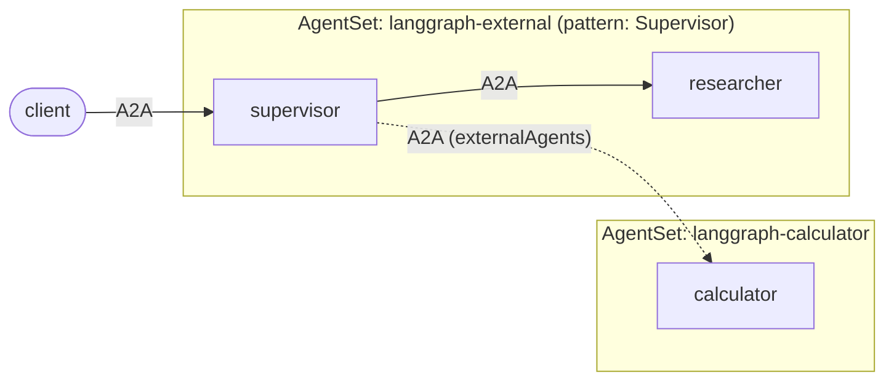

# LangGraph: calling an agent in another AgentSet

A supervisor that delegates to a worker that **lives in a different
`AgentSet`**. The [supervisor example](../supervisor) with one change: the
calculator is pulled out into its own `AgentSet`, and the supervisor's
`AgentSet` references it as an
[external agent](https://github.com/kynoproj/kynomesh/blob/main/docs/user-guide/reference/configuration/external-agents.md).



The agent code does not change. The supervisor still calls
`peer_client("calculator")`; whether `calculator` is a sibling or an external
agent is decided by the manifests.

| File                                 | Role                                                                                                    |
| ------------------------------------ | ------------------------------------------------------------------------------------------------------- |
| `manifests/calculator-agentset.yaml` | The calculator, deployed as its own `AgentSet`.                                                         |
| `manifests/agentset.yaml`            | Supervisor + researcher, with `externalAgents: [calculator]` pointing at the other `AgentSet`.          |
| `src/assistant/`                     | The same agents as the [supervisor example](../supervisor), served by one image selected with `--role`. |
| `tests/test_manifests.py`            | Checks the two manifests agree with each other and with the code.                                       |

## What an external agent is

Nothing is deployed for it in the supervisor's `AgentSet`: no pod, no broker, no
scaling or probing. It is a name and a URL, and Kynomesh adds it to the entry
agent's peers like any other. An external agent can be called but never be the
`entry`. Here the other `AgentSet` keeps managing its pods as usual.

An agent in another `AgentSet` is served at `https://<agentset>-<agent>:8490`
(add `.<namespace>.svc` to call across namespaces), which is the `url` in the
manifest.

## TLS

Peers in the same `AgentSet` are reached over each broker's self-signed
certificate, and the Kynomesh SDK skips verification for them. An **external**
peer is expected to present a CA-signed certificate, so it is verified. But the
calculator's broker is self-signed too, so verification would fail with
`CERTIFICATE_VERIFY_FAILED`. The supervisor therefore sets:

```yaml
- name: KYNOMESH_INSECURE_TLS_PEERS
  value: calculator
```

That gives the named external peer the same treatment as a sibling: encrypted,
but not authenticated. No code changes. Leave it out for a real external agent
with a CA-signed certificate. Any other auth the endpoint needs is the caller's
concern; Kynomesh has no broker in front of an external agent to configure it.

> **Requires** `kynomesh` 0.1.1 or newer, which added
> `KYNOMESH_INSECURE_TLS_PEERS`.

## Prerequisites

- Python 3.10+ and [uv](https://docs.astral.sh/uv/)
- An `OPENAI_API_KEY`. Agents refuse to start without one.
- [`a2acli`](https://github.com/kynoproj/a2acli)
- Docker, `kubectl`, and a local Kubernetes cluster with
  [Kynomesh installed](https://github.com/kynoproj/kynomesh/blob/main/docs/quick-start.md)

## 1. Run the tests

```shell
uv run pytest    # the LLM and the peer calls are mocked
```

## 2. Deploy

```shell
make build                     # builds langgraph-external:latest
# k3d:   k3d image import langgraph-external:latest -c <cluster>
# kind:  kind load docker-image langgraph-external:latest
kubectl create secret generic openai-api-key --from-literal=OPENAI_API_KEY=...
make deploy                    # the calculator AgentSet first, then the supervisor's
kubectl get agentset           # two AgentSets, both Running
kubectl get agentdeploy        # calculator belongs to langgraph-calculator
kubectl port-forward svc/langgraph-external-ingress 8490
```

Ask something that needs the researcher, then something that needs both:

```shell
a2acli -k -u https://localhost:8490 --override-host=localhost:8490 send 'What is the capital of France?'
a2acli -k -u https://localhost:8490 --override-host=localhost:8490 send 'What is the population of France multiplied by 3?'
```

The second question makes the supervisor call the calculator in the other
`AgentSet`. See it from the calculator side:

```shell
kubectl logs -l app.kubernetes.io/name=langgraph-calculator-calculator -c agent
```

Remove both with `make delete`.

Behind a TLS-intercepting proxy the image build fails certificate checks. Pass
the proxy CA: `make build CA_CERT=/path/to/ca.pem`.

> **Status:** unit tests pass and the manifests pass a server-side dry run. On
> k3d, a pod running this image (with `kynomesh` 0.1.1) called a managed agent
> in another `AgentSet` as an external peer: it failed TLS verification by
> default, and with `KYNOMESH_INSECURE_TLS_PEERS` it fetched the card and
> exchanged an A2A message. The two `AgentSet`s here have not been deployed end
> to end, because that needs an `OPENAI_API_KEY`.
